# Construction Workforce Dashboard — PostgreSQL Schema Reference

Source UI: `construction-workforce-dashboard-v80.html` (roles: **Admin**, **Office PM (OPM)**, **Site PM (SPM)**, **Client**)

This document specifies tables only (no DDL) so it can be handed to any DBA/ORM generator. Types are PostgreSQL-native.

---

## 1. Conventions

| Convention | Rule |
|---|---|
| Primary keys | `id UUID DEFAULT gen_random_uuid()` on every table (transaction/audit tables use `BIGSERIAL` for cheap sequential ordering) |
| Audit columns | **Every** table below carries `created_by UUID`, `created_at TIMESTAMPTZ NOT NULL DEFAULT now()`, `updated_by UUID`, `updated_at TIMESTAMPTZ NOT NULL DEFAULT now()`. Omitted from the column lists below for brevity — assume they exist on every table unless noted. `created_by`/`updated_by` reference `users.id`; nullable only for system-seeded rows. |
| Soft delete | Business tables carry `is_deleted BOOLEAN NOT NULL DEFAULT false` + `deleted_at`, `deleted_by`. Hard deletes are disallowed on transactional/history tables. |
| Enums | Implemented as `CHECK` constraints or Postgres `ENUM` types (either acceptable) — listed as `enum(...)`. |
| Naming | `snake_case`, singular table names avoided in favor of plural, junctions named `entity_a_entity_b` or by role. |
| Money/measures | `NUMERIC` for area/budget, never `FLOAT`. |
| Multi-tenant note | Schema assumes single-tenant (one contracting company, "10 Builders"). Add a `tenant_id` column across all tables if this becomes multi-tenant SaaS. |

---

## 2. Lookup / Reference Tables

### 2.1 `roles`
| Column | Type | Notes |
|---|---|---|
| id | SMALLINT PK | |
| code | VARCHAR(20) UNIQUE | `admin`, `opm`, `spm`, `client` |
| label | VARCHAR(50) | "Admin", "Office PM", "Site PM", "Client" |

### 2.2 `disciplines`
Engineering/labor disciplines used for SPM scope, worker discipline, and phase-team matching.
| Column | Type | Notes |
|---|---|---|
| id | SMALLINT PK | |
| code | VARCHAR(40) UNIQUE | Civil, Geotechnical, Structural, Mechanical, Electrical, Plumbing, Fire Protection, Acoustic, Facade, Waterproofing, Fire & Life Safety, Renovation, General Labor |

### 2.3 `project_types`
| Column | Type | Notes |
|---|---|---|
| id | SMALLINT PK | |
| code | VARCHAR(30) UNIQUE | Residential, Commercial, Mixed-Use, Infrastructure, Industrial, Renovation |
| max_opm_specializations | SMALLINT | business rule cap (2) lives here if it varies; otherwise enforced in app layer |

### 2.4 `project_stages`
Ordered construction lifecycle stages, shared by projects and phase-team rows.
| Column | Type | Notes |
|---|---|---|
| id | SMALLINT PK | |
| code | VARCHAR(30) UNIQUE | Mobilization, Design, Foundation, Structure, MEP Rough-in, Finishes, Closeout |
| sort_order | SMALLINT | drives progress bar / stepper ordering |

### 2.5 `trades`
Subcontractor trade categories (distinct from `disciplines`, which is used for individual engineers/workers).
| Column | Type | Notes |
|---|---|---|
| id | SMALLINT PK | |
| code | VARCHAR(60) UNIQUE | Structural / Rebar, Electrical, Mechanical / Plumbing, Facade, Waterproofing, Fire & Life Safety, etc. |

### 2.6 `certification_types`
| Column | Type | Notes |
|---|---|---|
| id | SMALLINT PK | |
| code | VARCHAR(40) UNIQUE | PRC-Civil, PRC-Architect, PRC-Mechanical, PRC-Electrical, DOLE-Safety, BFP-FireSafety, TESDA-Welding, ... |
| issuing_body | VARCHAR(100) | PRC, DOLE, BFP, TESDA |

### 2.7 `project_type_required_certifications` / `trade_required_certifications`
Two small mapping tables replacing `PROJECT_TYPE_REQUIRED_CERTS` / `TRADE_REQUIRED_CERTS`.
| Column | Type | Notes |
|---|---|---|
| project_type_id / trade_id | FK | composite PK with certification_type_id |
| certification_type_id | FK → certification_types | |

### 2.8 `document_types`
Registry of the 7 canonical project documents (`REPO_DOC_LABELS`).
| Column | Type | Notes |
|---|---|---|
| id | SMALLINT PK | 1–7 seeded |
| code | VARCHAR(60) UNIQUE | e.g. `notice_to_proceed` |
| label | VARCHAR(150) | "Notice to Proceed", "Approved Building Permit", etc. |
| is_client_visible_default | BOOLEAN | mirrors `REPO_DOC_CLIENT_VISIBLE` — single source of truth consumed by Share Links |
| is_required_for_intake | BOOLEAN | true for docs 1–6; doc 7 (subcon agreement) is conditional |

### 2.9 `activity_types`
| Column | Type | Notes |
|---|---|---|
| id | SMALLINT PK | |
| code | VARCHAR(20) UNIQUE | request, approval, progress, notice, login, logout, account, system |
| icon | VARCHAR(10) | emoji glyph used in UI |

---

## 3. Identity & Access

### 3.1 `users`
Represents every account: Admin, OPM, SPM, Client (`accounts` array in the UI).
| Column | Type | Notes |
|---|---|---|
| id | UUID PK | |
| full_name | VARCHAR(150) NOT NULL | |
| email | CITEXT UNIQUE NOT NULL | |
| phone | VARCHAR(30) | |
| password_hash | TEXT NOT NULL | bcrypt/argon2 — never store the temp password in plaintext beyond initial issuance |
| temp_password_issued | BOOLEAN DEFAULT true | forces reset on first login |
| role_id | SMALLINT FK → roles NOT NULL | |
| status | VARCHAR(20) enum('active','invited','suspended') NOT NULL DEFAULT 'invited' | |
| date_added | DATE NOT NULL DEFAULT current_date | separate from `created_at` to match business-facing "Added" column |
| last_login_at | TIMESTAMPTZ | |

### 3.2 `user_discipline_scopes`
SPM-only: one or more disciplines an SPM is qualified for. (junction, replaces `scope[]` for role=spm)
| Column | Type |
|---|---|
| user_id | FK → users |
| discipline_id | FK → disciplines |
| PK | (user_id, discipline_id) |

### 3.3 `user_project_type_specializations`
OPM-only: up to 2 project-type tags (`projectTypes[]`).
| Column | Type |
|---|---|
| user_id | FK → users |
| project_type_id | FK → project_types |
| PK | (user_id, project_type_id) |
| Constraint | app-level / trigger enforcing max 2 rows per `user_id` |

### 3.4 `user_client_project_links`
Client-only: which project(s) a client account may view (`scope[]` for role=client).
| Column | Type |
|---|---|
| user_id | FK → users |
| project_id | FK → projects |
| PK | (user_id, project_id) |

### 3.5 `user_licenses`
Professional license held by an internal user (OPM/SPM/Admin), one active row per user (history kept via audit_log + `superseded_at`).
| Column | Type | Notes |
|---|---|---|
| id | UUID PK | |
| user_id | FK → users NOT NULL | |
| license_number | VARCHAR(120) | e.g. "PRC Registered Civil Engineer No. 0091234" |
| license_expiry | DATE | drives the "Engineer Licenses Need Attention" banner |
| upload_file_ref | TEXT | pointer to object storage |
| upload_status | VARCHAR(20) enum('none','pending','uploaded') DEFAULT 'none' | matches `licenseUploadPending` / `pendingFileName` |
| superseded_at | TIMESTAMPTZ | set when a newer license row replaces this one |

### 3.6 `user_certifications`
| Column | Type |
|---|---|
| user_id | FK → users |
| certification_type_id | FK → certification_types |
| PK | (user_id, certification_type_id) |

### 3.7 `user_sessions` *(transactional)*
Backs login/logout activity entries and "who's currently signed in".
| Column | Type | Notes |
|---|---|---|
| id | BIGSERIAL PK | |
| user_id | FK → users NOT NULL | |
| login_at | TIMESTAMPTZ NOT NULL | |
| logout_at | TIMESTAMPTZ | |
| ip_address | INET | |
| user_agent | TEXT | |

---

## 4. Project Core

### 4.1 `projects`
Replaces both the intake-form draft state and `activeSites`. One row per project across its entire lifecycle.
| Column | Type | Notes |
|---|---|---|
| id | UUID PK | |
| name | VARCHAR(200) NOT NULL | |
| project_type_id | FK → project_types NOT NULL | |
| client_name | VARCHAR(150) | free-text client/company name from intake |
| floor_area_sqm | NUMERIC(10,2) | |
| floor_count | SMALLINT | |
| target_start_date | DATE | |
| current_stage_id | FK → project_stages | mirrors `stage` |
| current_pct | SMALLINT CHECK (0–100) | mirrors `pct` |
| crew_required | SMALLINT | denominator of "14 / 14" |
| crew_assigned | SMALLINT | numerator |
| lifecycle_status | VARCHAR(30) enum('draft','suggested_allocation','confirmed','sent_to_opm','spm_review','active','archived') | drives the 5-step intake stepper |
| suggested_opm_id | FK → users | |
| suggested_opm_match_score | SMALLINT | 0–100 |
| headcount_suggested | SMALLINT | |
| headcount_tier | VARCHAR(20) | Small/Medium/Large tier label |
| archived_at | TIMESTAMPTZ | |

### 4.2 `project_phase_team` *(transactional)*
Per-stage Site PM assignment (`phaseTeam[]` / suggested-allocation "Site PM per phase" panel). Also backs the OPM Confirmation Queue for SPM-side acceptance.
| Column | Type | Notes |
|---|---|---|
| id | BIGSERIAL PK | |
| project_id | FK → projects NOT NULL | |
| project_stage_id | FK → project_stages NOT NULL | |
| spm_user_id | FK → users NOT NULL | |
| is_lead | BOOLEAN DEFAULT false | true for the SPM who owns Mobilization / first stage |
| status | VARCHAR(20) enum('pending','confirmed','declined','auto_expired','reassigned') DEFAULT 'pending' | |
| response_deadline_at | TIMESTAMPTZ | "hard ceiling before auto-expire" |
| responded_at | TIMESTAMPTZ | |
| UNIQUE | (project_id, project_stage_id) | one SPM per stage per project |

### 4.3 `assignment_confirmations` *(transactional)*
Generalized OPM/SPM confirmation queue (`opmConfirmQueue`) for the whole-project (not per-phase) accept/decline step, including auto-escalation on non-response.
| Column | Type | Notes |
|---|---|---|
| id | BIGSERIAL PK | |
| project_id | FK → projects NOT NULL | |
| target_user_id | FK → users NOT NULL | the OPM or SPM being asked to confirm |
| role_context | VARCHAR(10) enum('opm','spm') | |
| match_score | SMALLINT | |
| status | VARCHAR(20) enum('pending','accepted','declined','auto_expired','reassigned') DEFAULT 'pending' | |
| responded_at | TIMESTAMPTZ | |
| escalated_to_admin | BOOLEAN DEFAULT false | |
| escalated_at | TIMESTAMPTZ | |
| reassigned_from_id | FK → assignment_confirmations | self-reference to the row it superseded |

### 4.4 `project_progress_history`
Append-only stage/% timeline (`site.history[]`). Never mutated once inserted — this is the auditable record behind the Client's downloadable progress report.
| Column | Type | Notes |
|---|---|---|
| id | BIGSERIAL PK | |
| project_id | FK → projects NOT NULL | |
| project_stage_id | FK → project_stages NOT NULL | |
| pct | SMALLINT | |
| note | TEXT | |
| is_issue | BOOLEAN DEFAULT false | |
| is_client_visible | BOOLEAN DEFAULT true | false only for the transient "submitted, pending review" / "flagged" entries |
| recorded_by | FK → users | |
| recorded_at | TIMESTAMPTZ | |

### 4.5 `pending_progress_updates` *(transactional)*
Holds an SPM-submitted update awaiting OPM review, including the 3-day auto-approve / material-change-escalation logic.
| Column | Type | Notes |
|---|---|---|
| id | BIGSERIAL PK | |
| project_id | FK → projects NOT NULL UNIQUE (one active pending update per project) | |
| prior_stage_id | FK → project_stages | |
| prior_pct | SMALLINT | |
| requested_stage_id | FK → project_stages | |
| requested_pct | SMALLINT | |
| note | TEXT | |
| is_material_change | BOOLEAN | computed: stage or % actually differs |
| submitted_by | FK → users | |
| submitted_at | TIMESTAMPTZ | |
| auto_approve_deadline_at | TIMESTAMPTZ | `submitted_at + 3 days` |
| status | VARCHAR(20) enum('pending','auto_approved','approved','escalated','rejected') DEFAULT 'pending' | |
| escalated_at | TIMESTAMPTZ | |
| resolved_by | FK → users | null when auto-approved by the system |
| resolved_at | TIMESTAMPTZ | |
| resulting_history_id | FK → project_progress_history | link to the history row it produced once resolved |

### 4.6 `pending_rework_requests` *(transactional)*
Issue-flagged updates — always require manual OPM/Admin review, never auto-approved.
| Column | Type | Notes |
|---|---|---|
| id | BIGSERIAL PK | |
| project_id | FK → projects NOT NULL | |
| project_stage_id | FK → project_stages | |
| reason | TEXT | |
| submitted_by | FK → users | |
| submitted_at | TIMESTAMPTZ | |
| status | VARCHAR(20) enum('pending','approved','rejected') DEFAULT 'pending' | |
| resolved_by | FK → users | |
| resolved_at | TIMESTAMPTZ | |
| resolution_note | TEXT | |

### 4.7 `project_photos`
| Column | Type | Notes |
|---|---|---|
| id | UUID PK | |
| project_id | FK → projects NOT NULL | |
| file_ref | TEXT NOT NULL | object storage URL/key |
| caption | VARCHAR(300) | |
| taken_date | DATE | |
| uploaded_by | FK → users | |

### 4.8 `project_engineers`
Assignment of internal engineers to a project (`site.engineers[]`) beyond the phase-team SPM (QA/QC, Safety Officer, oversight OPM).
| Column | Type | Notes |
|---|---|---|
| id | UUID PK | |
| project_id | FK → projects NOT NULL | |
| user_id | FK → users NOT NULL | |
| project_role_label | VARCHAR(80) | "Site PM", "Office PM (oversight)", "QA/QC Engineer", "Safety Officer" |
| assigned_at | TIMESTAMPTZ | |
| unassigned_at | TIMESTAMPTZ | nullable = currently active |

### 4.9 `project_notes`
| Column | Type | Notes |
|---|---|---|
| id | UUID PK | |
| project_id | FK → projects NOT NULL | |
| author_id | FK → users | |
| note_text | TEXT NOT NULL | |
| noted_at | TIMESTAMPTZ | |

---

## 5. Subcontractors & Workforce

### 5.1 `subcontractors`
Union of `SUGGESTED_SUBCONS` + `DIRECTORY_SUBCONS`.
| Column | Type | Notes |
|---|---|---|
| id | UUID PK | |
| company_name | VARCHAR(150) NOT NULL | |
| trade_id | FK → trades NOT NULL | |
| contact_email | CITEXT | |
| meta_description | VARCHAR(300) | e.g. "12 active crews · 22 floors delivered avg." |
| source | VARCHAR(20) enum('system_matched','directory') | matched subcons carry a `match` score; directory ones don't |
| committed_until | DATE | drives double-booking check |

### 5.2 `project_subcontractor_matches`
Ephemeral system-generated match scores per project × subcontractor (only relevant while allocation is being suggested; superseded once assigned).
| Column | Type |
|---|---|
| project_id | FK → projects |
| subcontractor_id | FK → subcontractors |
| match_score | SMALLINT |
| cert_coverage_pct | SMALLINT |
| PK | (project_id, subcontractor_id) |

### 5.3 `project_subcontractor_assignments` *(transactional)*
Confirmed subcon-to-project-trade assignment (`site.subconWorkers[]` summary rows).
| Column | Type | Notes |
|---|---|---|
| id | UUID PK | |
| project_id | FK → projects NOT NULL | |
| subcontractor_id | FK → subcontractors NOT NULL | |
| trade_id | FK → trades NOT NULL | |
| worker_count | SMALLINT | |
| status | VARCHAR(20) enum('active','released') DEFAULT 'active' | |
| assigned_at | TIMESTAMPTZ | |
| released_at | TIMESTAMPTZ | |

### 5.4 `pending_subcontractor_requests` *(transactional)*
SPM-initiated request to add/swap a subcontractor on a project, including double-booking conflict flag.
| Column | Type | Notes |
|---|---|---|
| id | UUID PK | |
| project_id | FK → projects NOT NULL | |
| subcontractor_id | FK → subcontractors NOT NULL | |
| trade_id | FK → trades | |
| requested_by | FK → users | |
| requested_at | TIMESTAMPTZ | |
| has_conflict | BOOLEAN DEFAULT false | true when `committed_until` overlaps the requesting project's start date |
| status | VARCHAR(20) enum('pending','approved','rejected') DEFAULT 'pending' | |
| resolved_by | FK → users | |
| resolved_at | TIMESTAMPTZ | |

### 5.5 `subcontractor_workers`
| Column | Type | Notes |
|---|---|---|
| id | UUID PK | |
| subcontractor_id | FK → subcontractors NOT NULL | |
| full_name | VARCHAR(150) NOT NULL | |
| role_title | VARCHAR(100) | "Crew Foreman", "Rebar Leadman", etc. |
| phone | VARCHAR(30) | |
| status | VARCHAR(20) enum('active','inactive') | |
| discipline_id | FK → disciplines | |
| license_number | VARCHAR(120) | |
| license_expiry | DATE | |
| availability_status | VARCHAR(20) enum('assigned','available') | |
| availability_note | VARCHAR(200) | |
| current_project_id | FK → projects | nullable |
| current_project_until | VARCHAR(30) | display string, e.g. "Nov 2026" |

### 5.6 `worker_certifications`
| Column | Type |
|---|---|
| worker_id | FK → subcontractor_workers |
| certification_type_id | FK → certification_types |
| PK | (worker_id, certification_type_id) |

### 5.7 `worker_employment_history`
| Column | Type | Notes |
|---|---|---|
| id | UUID PK | |
| worker_id | FK → subcontractor_workers NOT NULL | |
| external_project_name | VARCHAR(200) | free text — prior projects not necessarily in this system |
| role_title | VARCHAR(100) | |
| period_start | DATE | |
| period_end | DATE | nullable = ongoing |

---

## 6. Documents & Contracts

### 6.1 `project_documents` *(transactional)*
Backs the 6-document intake checklist + subcon agreement per project (`DOC_REPO_STATIC` / live intake checklist).
| Column | Type | Notes |
|---|---|---|
| id | UUID PK | |
| project_id | FK → projects NOT NULL | |
| document_type_id | FK → document_types NOT NULL | |
| status | VARCHAR(20) enum('not_uploaded','uploaded') DEFAULT 'not_uploaded' | |
| file_ref | TEXT | object storage pointer |
| uploaded_by | FK → users | |
| uploaded_at | TIMESTAMPTZ | |
| UNIQUE | (project_id, document_type_id) | |

### 6.2 `contracts` *(transactional)*
Client Contract Agreement and optional Client-&-Subcontractor Agreement uploaded during intake.
| Column | Type | Notes |
|---|---|---|
| id | UUID PK | |
| project_id | FK → projects NOT NULL | |
| contract_type | VARCHAR(30) enum('client_contract','client_subcon_agreement') | |
| subcontractor_name | VARCHAR(150) | only for `client_subcon_agreement` |
| trade_scope | VARCHAR(150) | only for `client_subcon_agreement` |
| file_ref | TEXT NOT NULL | |
| uploaded_by | FK → users | |
| uploaded_at | TIMESTAMPTZ | |
| is_locked | BOOLEAN DEFAULT true | client-subcon agreement can't be removed once sent to OPM |

---

## 7. Sharing & Notifications

### 7.1 `share_links` *(transactional)*
| Column | Type | Notes |
|---|---|---|
| id | UUID PK | |
| project_id | FK → projects NOT NULL | |
| token | VARCHAR(64) UNIQUE NOT NULL | crypto-random, not sequential |
| scope | VARCHAR(20) enum('overview','milestone','documents') | |
| expiry_option | VARCHAR(10) enum('24h','7d','30d','none') | |
| expires_at | TIMESTAMPTZ | null when `none` |
| revoked | BOOLEAN DEFAULT false | |
| revoked_at | TIMESTAMPTZ | |
| revoked_by | FK → users | |

### 7.2 `share_link_excluded_documents`
Internal-only document types manually excluded from a `documents`-scoped share link (on top of the `is_client_visible_default = false` floor, which can never be overridden to true).
| Column | Type |
|---|---|
| share_link_id | FK → share_links |
| document_type_id | FK → document_types |
| PK | (share_link_id, document_type_id) |

### 7.3 `share_link_access_log` *(transactional/audit)*
| Column | Type |
|---|---|
| id | BIGSERIAL PK |
| share_link_id | FK → share_links |
| accessed_at | TIMESTAMPTZ |
| ip_address | INET |

### 7.4 `activity_log` *(transactional/audit — append-only)*
Backs both the global Activity Log drawer and the notification bell (`activityLog[]`).
| Column | Type | Notes |
|---|---|---|
| id | BIGSERIAL PK | |
| activity_type_id | FK → activity_types NOT NULL | |
| title | VARCHAR(200) NOT NULL | |
| detail | TEXT | |
| actor_user_id | FK → users | null = "System" |
| target_role_id | FK → roles | which role's feed this surfaces on |
| anchor_reference | VARCHAR(80) | client-side section/card key to deep-link to |
| related_project_id | FK → projects | nullable, for filtering |
| occurred_at | TIMESTAMPTZ NOT NULL DEFAULT now() | |

### 7.5 `notification_recipients`
Per-user read state against an activity feed entry (`unread` flag, but tracked per-recipient rather than globally).
| Column | Type |
|---|---|
| activity_log_id | FK → activity_log |
| recipient_user_id | FK → users |
| is_read | BOOLEAN DEFAULT false |
| read_at | TIMESTAMPTZ |
| PK | (activity_log_id, recipient_user_id) |

---

## 8. Generic Audit Trail

### 8.1 `audit_log` *(system table — populated by triggers, not application code)*
Captures every INSERT/UPDATE/DELETE across all business tables in one place, independent of the per-table `created_by/updated_by` columns (which record "current" state ownership; `audit_log` records full history).
| Column | Type | Notes |
|---|---|---|
| id | BIGSERIAL PK | |
| table_name | VARCHAR(60) NOT NULL | |
| record_id | TEXT NOT NULL | cast to text to support UUID and BIGSERIAL PKs uniformly |
| operation | VARCHAR(10) enum('INSERT','UPDATE','DELETE') NOT NULL | |
| changed_by | FK → users | resolved from session context (`app.current_user_id` GUC) |
| changed_at | TIMESTAMPTZ NOT NULL DEFAULT now() | |
| old_values | JSONB | null on INSERT |
| new_values | JSONB | null on DELETE |

**Trigger strategy:** attach a single reusable `AFTER INSERT OR UPDATE OR DELETE` trigger function to every table listed in §3–§7 that writes a row into `audit_log` with `to_jsonb(OLD)`/`to_jsonb(NEW)`. This gives full CRUD auditability without duplicating per-column history tables everywhere.

### 8.2 Tables classified as **transactional** (business workflow / approval steps — first-class audit priority, in addition to generic trigger coverage above)
- `project_phase_team`
- `assignment_confirmations`
- `pending_progress_updates`
- `pending_rework_requests`
- `pending_subcontractor_requests`
- `project_subcontractor_assignments`
- `project_documents`
- `contracts`
- `share_links` / `share_link_access_log`
- `activity_log` (itself the audit surface for user-facing events)
- `user_sessions`

These tables should never be hard-deleted, always carry explicit `status` + timestamp columns for each state transition, and are the primary source for compliance/investigation queries (e.g. "who approved this progress update and when").

---

## 9. Entity Relationship Overview

```mermaid
erDiagram
  ROLES ||--o{ USERS : has
  USERS ||--o{ USER_DISCIPLINE_SCOPES : scoped_to
  USERS ||--o{ USER_PROJECT_TYPE_SPECIALIZATIONS : specializes_in
  USERS ||--o{ USER_CLIENT_PROJECT_LINKS : views
  USERS ||--o{ USER_LICENSES : holds
  USERS ||--o{ USER_CERTIFICATIONS : holds
  USERS ||--o{ USER_SESSIONS : logs_in

  PROJECT_TYPES ||--o{ PROJECTS : classifies
  PROJECTS ||--o{ PROJECT_PHASE_TEAM : staffed_by
  PROJECTS ||--o{ ASSIGNMENT_CONFIRMATIONS : awaits
  PROJECTS ||--o{ PROJECT_PROGRESS_HISTORY : tracks
  PROJECTS ||--o{ PENDING_PROGRESS_UPDATES : has
  PROJECTS ||--o{ PENDING_REWORK_REQUESTS : has
  PROJECTS ||--o{ PROJECT_PHOTOS : has
  PROJECTS ||--o{ PROJECT_ENGINEERS : staffed_by
  PROJECTS ||--o{ PROJECT_NOTES : has
  PROJECTS ||--o{ PROJECT_DOCUMENTS : requires
  PROJECTS ||--o{ CONTRACTS : requires
  PROJECTS ||--o{ SHARE_LINKS : exposes
  PROJECTS ||--o{ PROJECT_SUBCONTRACTOR_ASSIGNMENTS : assigns
  PROJECTS ||--o{ PENDING_SUBCONTRACTOR_REQUESTS : requests

  SUBCONTRACTORS ||--o{ SUBCONTRACTOR_WORKERS : employs
  SUBCONTRACTORS ||--o{ PROJECT_SUBCONTRACTOR_ASSIGNMENTS : fulfills
  SUBCONTRACTOR_WORKERS ||--o{ WORKER_CERTIFICATIONS : holds
  SUBCONTRACTOR_WORKERS ||--o{ WORKER_EMPLOYMENT_HISTORY : has

  SHARE_LINKS ||--o{ SHARE_LINK_EXCLUDED_DOCUMENTS : excludes
  SHARE_LINKS ||--o{ SHARE_LINK_ACCESS_LOG : accessed_via

  ACTIVITY_LOG ||--o{ NOTIFICATION_RECIPIENTS : delivered_to
```

